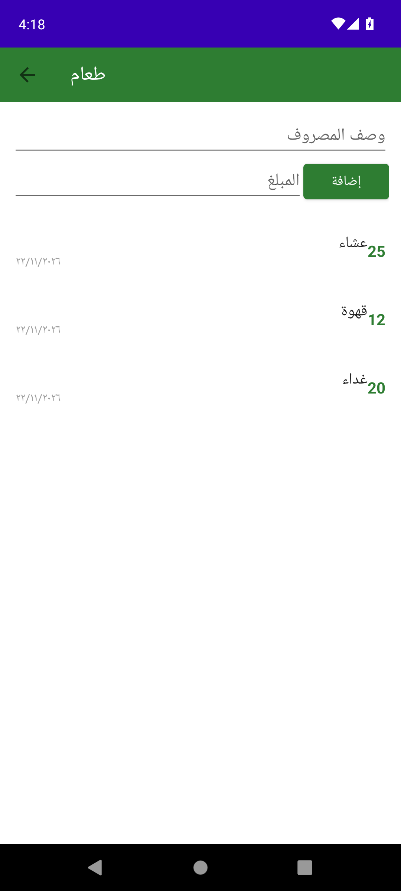
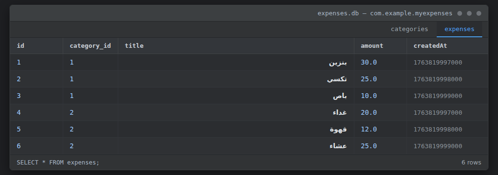
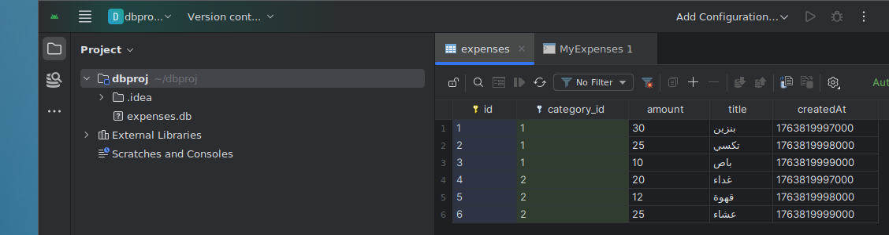

# MyExpenses – تطبيق «مصاريفي»

**الاسم:** عبد العزيز إسماعيل الأشقر
**الرقم الجامعي:** 120235149
**المساق:** DCSC 2305 – ورش برمجة الهواتف ذكية (2)
**التكليف:** Assignment 1 – Room Database

## عن التطبيق

تطبيق أندرويد (Java) لتسجيل المصاريف الشخصية موزّعة على تصنيفات مثل: مواصلات، طعام، كتب.
لكل تصنيف ميزانية شهرية، ولكل مصروف تصنيف واحد. البيانات محفوظة في قاعدة Room من جدولين
بينهما علاقة واحد إلى متعدد (تصنيف واحد له مصاريف كثيرة).

## الجداول

**categories**

| الحقل | النوع | ملاحظة |
|------|------|--------|
| id | int | مفتاح أساسي يتولد تلقائياً |
| name | String | اسم التصنيف |
| budget | double | الميزانية الشهرية |

**expenses**

| الحقل | النوع | ملاحظة |
|------|------|--------|
| id | int | مفتاح أساسي يتولد تلقائياً |
| category_id | int | مفتاح أجنبي يشير إلى categories.id |
| title | String | وصف المصروف |
| amount | double | المبلغ |
| createdAt | long | وقت الإضافة System.currentTimeMillis() |

حذف تصنيف يحذف كل مصاريفه تلقائياً: `onDelete = CASCADE`.

## البنية

- `Category`, `Expense` : جداول Room.
- `CategoryDao` : إضافة وحذف + `getCategoriesWithTotal()` ترجع لكل تصنيف اسمه وميزانيته ومجموع مصاريفه كـ LiveData.
- `ExpenseDao` : إضافة وحذف + `getByCategory(categoryId)` ترجع مصاريف تصنيف واحد من الأحدث إلى الأقدم كـ LiveData.
- `ExpenseDatabase` : كلاس القاعدة، نسخة واحدة (Singleton)، اسم الملف `expenses.db`، والكتابة على خيط IO في الخلفية.
- `MainActivity` : شاشة التصنيفات (اسم + ميزانية + زر إضافة، وقائمة التصنيفات).
- `ExpensesActivity` : شاشة المصاريف، تُفتح بالضغط على تصنيف ويُمرَّر رقمه واسمه عبر Intent.

## الميزات

- عرض كل تصنيف مع المجموع / الميزانية، والرقم يظهر باللون الأحمر إذا تجاوز المجموع الميزانية.
- حذف التصنيف أو المصروف بالضغط المطول بعد نافذة تأكيد، مع تنبيه أن حذف التصنيف يحذف مصاريفه.
- القوائم تتحدث وحدها عبر `observe` بدون إعادة تحميل.
- (إضافي) مجموع كل المصاريف يظهر في شريط العنوان مثل `Total: 240.5` ويتحدث لوحده.

## الصور

شاشة التصنيفات (لاحظ أن «طعام» صار أحمر لأن مجموعه 57 تجاوز ميزانيته 50، والمجموع الكلي 122):

شاشة مصاريف تصنيف «طعام» مع وصف المصروف والمبلغ والتاريخ:

جدول `expenses` كما هو محفوظ داخل قاعدة البيانات (نفس الصفوف التي أُضيفت من التطبيق):

نفس الجدول مفتوحًا داخل Android Studio والصفوف ظاهرة فيه:

## طريقة التشغيل

1. افتح المشروع في Android Studio.
2. شغّل التطبيق على محاكي أو جهاز.
3. أضف تصنيفين (مثلاً مواصلات وطعام)، وأضف لكل تصنيف ثلاثة مصاريف بحيث يتجاوز أحد التصنيفات ميزانيته.
